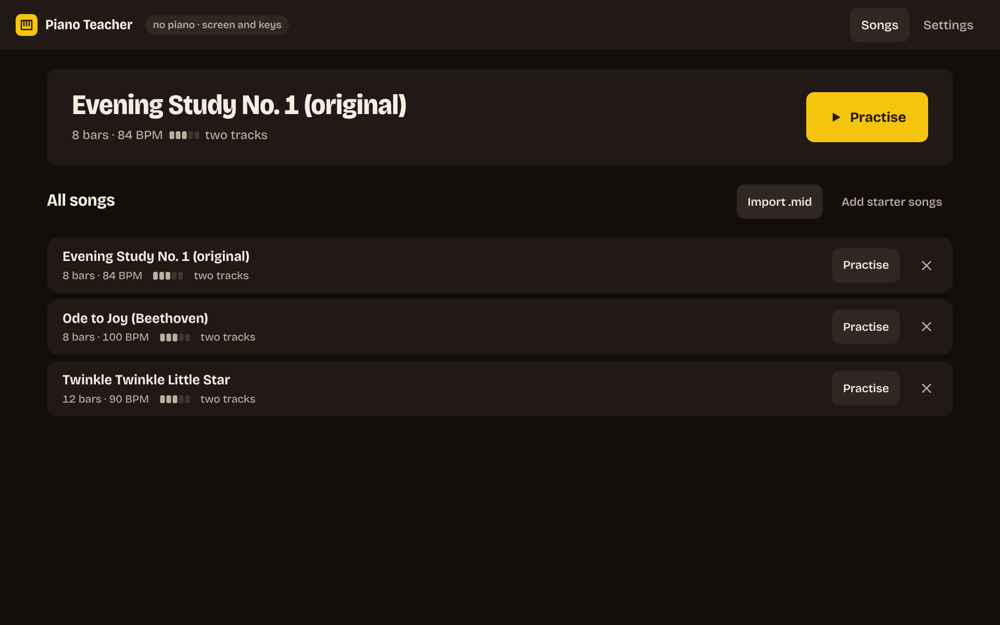
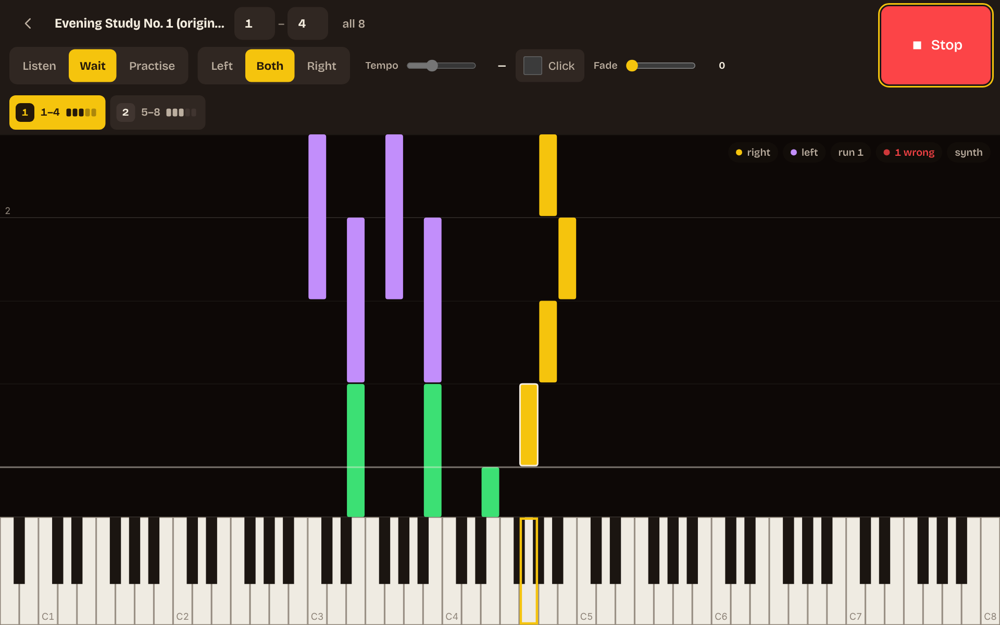
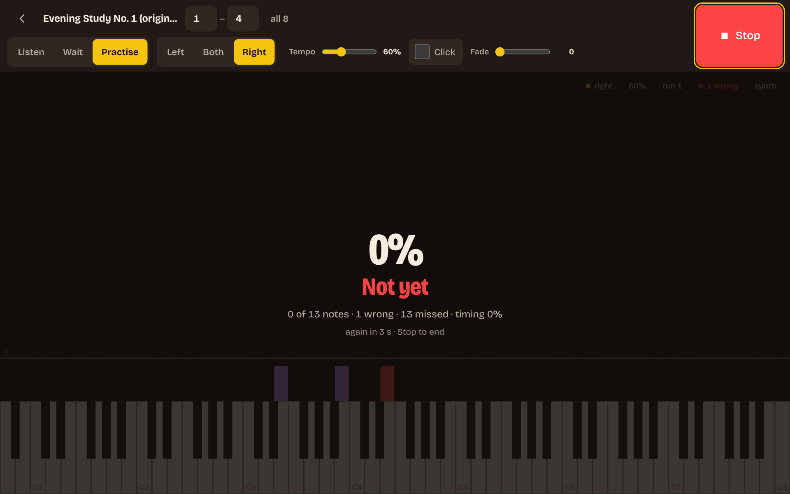
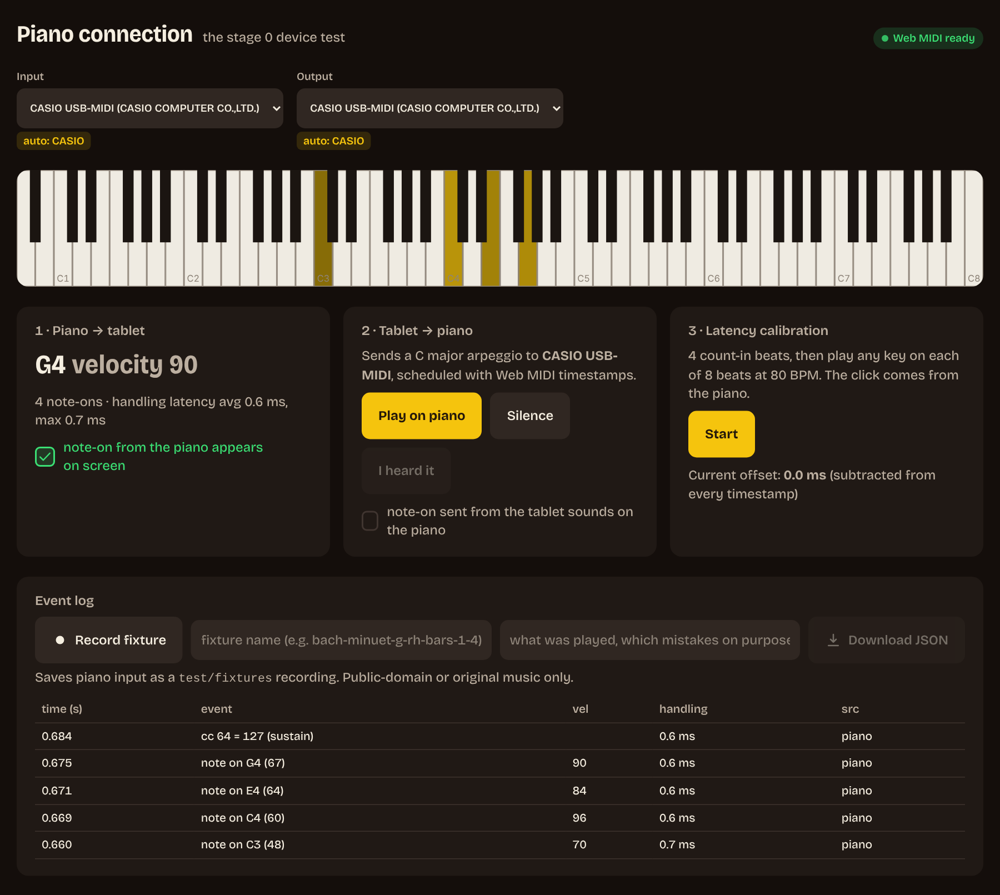

# Piano Teacher

A web app (PWA) for an Android tablet that sits on the music stand of a MIDI piano and teaches
you to play **whole songs, both hands, at tempo, from memory**. It listens to the piano over
USB-MIDI, shows falling notes, scores every note you play, and then takes the notes away step
by step until you can play the passage on a blank screen. Mastered passages come back on a
spaced-repetition schedule so you build a repertoire instead of forgetting last month's song.

It is built for a small, closed group of friends who had a few piano lessons as kids and want
to actually finish songs now. Reading staff notation is explicitly **not** a goal.

**Status: stage 1 of 5** – basic player. Import a MIDI file, pick a hand and a bar range, and
practise it in wait mode or at a fixed tempo with per-note feedback. Works with a MIDI piano
**and without one** (on-screen or computer keyboard, synth on the tablet). Neither stage has
been verified on the real tablet and piano yet. See [Roadmap](#roadmap).



_Home: the song you were on, one button. Brass is the thing to do next; it is also the
right hand's colour on the practice screen._



_Wait mode: hit notes turn green, the chord the cursor waits on is outlined, the key to play
is outlined on the keyboard (fade level 0)._



_After each run: the verdict lands for three seconds, then the next run starts by itself._

## How it teaches

Every feature exists to shorten the time until a passage is mastered. The method, from
[docs/pedagogy.md](docs/pedagogy.md):

1. **Hear it first.** The piano itself plays every new segment before you practise it.
2. **Chunk.** Songs are split into 2–4 bar segments; you only move on after mastering one.
3. **Slow and correct before fast.** Wait mode, then an adaptive tempo from 60 % up.
4. **Hands separately**, then together slowly, together at tempo, then from memory.
5. **Drill the hard bits.** Hotspots are detected from your error statistics and looped.
6. **Retrieve, don't re-read.** The falling notes fade out over five levels until the screen is
   blank. Mastery means playing with no visual aid.
7. **Spaced repetition** (SM-2 style) keeps mastered segments alive, always from memory.
8. **Immediate, precise feedback.** Every note is coloured by timing (early / late / wrong).

No points, badges or leaderboards. Progress is the feedback: tempo going up, segments
turning "mastered", reviews getting further apart.

## Hardware

| Part   | Requirement                                                                                                                    |
| ------ | ------------------------------------------------------------------------------------------------------------------------------ |
| Piano  | Any class-compliant USB-MIDI piano. Built for a Casio with a **USB-B ("USB to Host")** socket; no driver needed.               |
| Tablet | Android, 10" or larger, recent Chrome. Used in landscape on the music stand.                                                   |
| Cable  | **USB-C OTG → USB-B.** Prefer an OTG hub with power-delivery passthrough, otherwise the tablet battery drains during practice. |
| Pedal  | Sustain (CC 64) is received and logged, not evaluated in the MVP.                                                              |

If the piano only has 5-pin MIDI DIN sockets, any cheap USB-MIDI interface works.

The piano makes all the sound: your own playing and the demonstrations the app sends back
over MIDI out. The tablet stays silent, so there is no Android audio latency to fight.

## Quick start

```bash
git clone https://github.com/oriamos/piano_teacher.git
cd piano_teacher
npm install
npm run dev          # http://localhost:5173  (also reachable on the LAN via --host)
```

Open it in desktop Chrome or Edge. Press **Add the starter songs** in the library (three
public-domain tunes ship with the app), open one and press **Start**.

### Bringing your own sheet music

**Import sheet music** accepts:

| File                        | Source                                                                                                                                                                                                    |
| --------------------------- | --------------------------------------------------------------------------------------------------------------------------------------------------------------------------------------------------------- |
| `.musicxml`, `.xml`, `.mxl` | Notation: MuseScore (File → Export), Sibelius, Finale, Dorico, and most OMR tools. Staff 1 becomes the right hand, staff 2 the left. Ties, chords, voices, tuplets, pickup bars and tempo marks are read. |
| `.mid`, `.midi`             | Any MIDI file. Hands by track name or pitch, with a movable split point.                                                                                                                                  |

A **PDF or photo of a score** is a picture, not notes. Run it through optical music
recognition first: in [MuseScore](https://musescore.org) use _File → Import PDF_ (free, uses
Audiveris in the cloud), or install [Audiveris](https://audiveris.github.io/audiveris/) and
open the PDF there. Check the result against the page, export MusicXML, import that. The app
says exactly this if you try to import a PDF.

From the notes the app builds the training: it splits the piece into 2–4 bar **segments** by
note density (cutting at phrase ends when it has to cut early), rates each segment's
difficulty from density, chords and leaps, and opens the practice screen on segment 1. The
segment strip above the notes is the plan; tap a segment to loop it. The per-segment stage
sequence (listen → right → left → both → memory) and automatic progression arrive with
stage 2.

### Two modes: with a piano, without one

| Mode         | Input                                                                                                                                        | Sound                                                |
| ------------ | -------------------------------------------------------------------------------------------------------------------------------------------- | ---------------------------------------------------- |
| **Piano**    | The piano over USB-MIDI (auto-selected when its name contains "CASIO")                                                                       | The piano itself, incl. demonstrations over MIDI out |
| **No piano** | Tap the on-screen keyboard, or type: `A W S E D F T G Y H U J K O L P ; '` = C4 upward, `Z`/`X` octave down/up, hold Shift for a louder note | A small synth on the tablet / laptop                 |

Switching is automatic: when a MIDI output is connected the piano plays, otherwise the synth
does. Settings lets you force either, or silence. Everything else (matching, feedback,
scoring) is identical in both modes; see [ADR 0005](docs/adr/0005-no-piano-mode.md).

### The practice screen

- **Mode**: _Listen_ plays the range; _Wait_ stops at each chord until you play it (wrong
  notes are counted, time is not); _Practice_ runs at a fixed tempo (40–100 %) and colours
  each note green / blue / orange / red for precise / early / late / wrong, blinking red for
  missed, with a score after the run.
- **Hand**: left, right or both. The hand you are not playing is played for you.
- **Bars**: an A–B loop by bar numbers. **Click** adds a metronome; timed runs start with a
  one-bar count-in.
- **Fade**: 0 shows notes and highlights the target keys, 1 notes only, 2 notes that vanish
  halfway, 3 only the first note of each bar, 4 a blank screen (play from memory).
- After each run a 3-second summary shows, then the next run starts by itself. Stop ends it.

Useful scripts:

| Script              | What it does                                                        |
| ------------------- | ------------------------------------------------------------------- |
| `npm run dev`       | Dev server on all interfaces (HTTP)                                 |
| `npm run dev:https` | Same, over HTTPS with a self-signed certificate                     |
| `npm run check`     | Lint + typecheck (incl. the DOM-free engine check) + tests + build  |
| `npm test`          | Vitest unit tests                                                   |
| `npm run build`     | Production build into `dist/` (installable PWA with service worker) |
| `npm run preview`   | Serve `dist/`                                                       |

### Running on the tablet

Web MIDI only works in a **secure context**: `https://…` or `http://localhost`. Pick one:

1. **`adb reverse` (recommended for development).** Enable USB debugging on the tablet,
   connect it to the dev machine and run `adb reverse tcp:5173 tcp:5173`. Then open
   `http://localhost:5173` on the tablet: `localhost` counts as secure, no certificates
   needed. The piano stays plugged into the tablet's OTG hub.
2. **Self-signed HTTPS.** `npm run dev:https`, then open `https://<dev-machine-ip>:5173` on
   the tablet and accept the certificate warning.
3. **A tunnel.** Any HTTPS tunnel to port 5173 (`cloudflared tunnel --url http://localhost:5173`,
   `ngrok http 5173`, …).
4. **A deployment.** The production build is a static site; a Vercel preview URL is HTTPS.

Then, on the tablet: Chrome → open the URL → allow MIDI when prompted → menu → _Install app_
(or _Add to Home screen_). The installed app opens fullscreen in landscape.

### Connecting the piano

1. Plug the OTG hub into the tablet, the USB-B cable into the piano, power on the piano.
2. Open the app. The device-test screen lists MIDI inputs and outputs and auto-selects the
   port whose name contains "CASIO" (configurable in `src/config.ts`).
3. Press a key: it lights up on the virtual keyboard with its velocity.
4. Press **Play on piano**: the piano should play a C major arpeggio.
5. Run the **latency calibration** once and save the offset.

If you unplug the cable mid-session, a banner appears and the app reconnects by itself when
the piano is back.



## Self-hosting (from stage 4)

The practice engine runs entirely on the tablet; a backend is only needed for multi-user
login, the shared song library and progress sync. That backend is a
[Supabase](https://supabase.com) project on the free tier:

1. Create a Supabase project.
2. Apply the migrations in `supabase/migrations/` (arrives with stage 4) – they create the
   tables listed in [docs/architecture.md](docs/architecture.md) with Row Level Security so
   users only ever see their own progress.
3. Copy `.env.example` to `.env.local` and fill in `VITE_SUPABASE_URL` and
   `VITE_SUPABASE_ANON_KEY`. The anon key is safe in the client; the `service_role` key must
   never appear anywhere in this repo.
4. Deploy `dist/` to any static host (Vercel is what we use).
5. Sign-up is by invite code. The code is open; your server stays closed.

## Project layout

```
src/
  config.ts   every numeric threshold (windows, percentages, α, EF) – nothing is hard-coded
  midi/       Web MIDI: connection, hot-plug, timestamps, scheduled output, calibration,
              computer-keyboard input, fixture recorder
  audio/      the Instrument interface: piano over MIDI out, or the Web Audio synth
  engine/     pure TypeScript, no DOM: grouping, wait/timed matching, scoring, the practice
              session controller (stage 2 adds the stage machine, tempo, hotspots, SRS)
  content/    MIDI and MusicXML (.mxl) parsing → internal event format, hands, segmentation,
              difficulty
  render/     Canvas: virtual keyboard, falling notes, fade levels
  ui/         React screens (library, practice, settings) and the browser adapter
  store/      Dexie / IndexedDB: songs, settings (progress and the sync queue come later)
  sync/       (stage 4) Supabase
scripts/      seed-songs.mjs regenerates the bundled public-domain starter songs
public/songs/ the starter songs (.mid)
docs/         architecture, algorithms, pedagogy, UI reference, ADRs
test/fixtures real MIDI recordings (JSON) the engine is tested against
```

Three rules are enforced by tooling, not convention: the engine imports nothing from the UI or
the browser (`tsconfig.engine.json` compiles it without the DOM lib, plus an ESLint rule and a
test); timing never uses `Date.now()` (ESLint); MIDI out is scheduled with Web MIDI timestamps,
never `setTimeout`.

## Roadmap

Each stage ends with a pass condition checked **on the piano**, not just in code.

| Stage | Scope                                                                                  | Pass condition                                                         | Status                         |
| ----- | -------------------------------------------------------------------------------------- | ---------------------------------------------------------------------- | ------------------------------ |
| 0     | Hardware validation page                                                               | Note-on from the piano shows on screen; note-on from the tablet sounds | built, awaiting hardware check |
| 1     | Basic player: MIDI import, hand split, falling notes, wait mode, hand select, A–B loop | Play a 4-bar segment in wait mode with correct per-note feedback       | next                           |
| 2     | Practice engine: segmentation, LISTEN, state machine, adaptive tempo, fading, drills   | One whole song goes LISTEN → MASTERED, including stitching             |                                |
| 3     | Spaced repetition and the daily session builder, summaries, stats                      | Two weeks of real daily use without choosing what to practise          |                                |
| 4     | Users: Supabase auth, invite codes, shared library, sync, starter curriculum           | Two friends practise in parallel with separate data                    |                                |
| 5     | Ear training module (echo, scale degrees, chords, songs by ear, transposition)         |                                                                        |                                |

Out of scope by design: staff notation, audio recognition from an acoustic piano, iOS,
gamification and rankings, AI, video lessons.

## Design

The look is recorded in [DESIGN.md](DESIGN.md) (tokens, type, motion, the rules) and the
product truth it serves in [PRODUCT.md](PRODUCT.md). In short: a warm near-black ground like
a piano case, ivory text, one brass accent for the thing to do next, violet for the left hand,
the four feedback colours fixed by the spec. Nothing glows. The typeface is
[Bricolage Grotesque](https://github.com/ateliertriay/bricolage) (OFL), self-hosted in
`public/fonts/`.

## Documentation

- [SPEC.md](SPEC.md) – the full specification (Hebrew)
- [PRODUCT.md](PRODUCT.md) and [DESIGN.md](DESIGN.md) – product truth and the visual system
- [docs/architecture.md](docs/architecture.md) – layers, the MIDI event path end to end, the
  internal event format, data model
- [docs/algorithms.md](docs/algorithms.md) – matching, scoring, adaptive tempo, hotspots,
  spaced repetition, fading, session builder, with every threshold and its rationale
- [docs/pedagogy.md](docs/pedagogy.md) – the principles and how each one is implemented
- [docs/ui-reference.md](docs/ui-reference.md) – which UI patterns are borrowed from which
  app, and the rules for doing that legally
- [docs/adr/](docs/adr/) – architecture decision records
- [CONTRIBUTING.md](CONTRIBUTING.md) – dev setup, tests, code style, commits, adding fixtures
- [CHANGELOG.md](CHANGELOG.md)

## License

[MIT](LICENSE). All code and assets are original; dependencies are permissively licensed
(MIT / Apache / BSD). The Bricolage Grotesque font in `public/fonts/` is under the SIL Open
Font License 1.1 (see `public/fonts/OFL.txt`). No music under copyright is or will be committed to this repository:
fixtures and seed songs are original or public domain.
